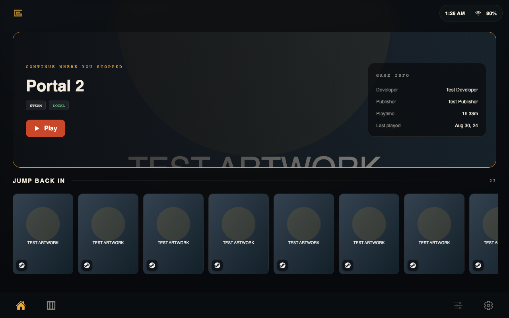
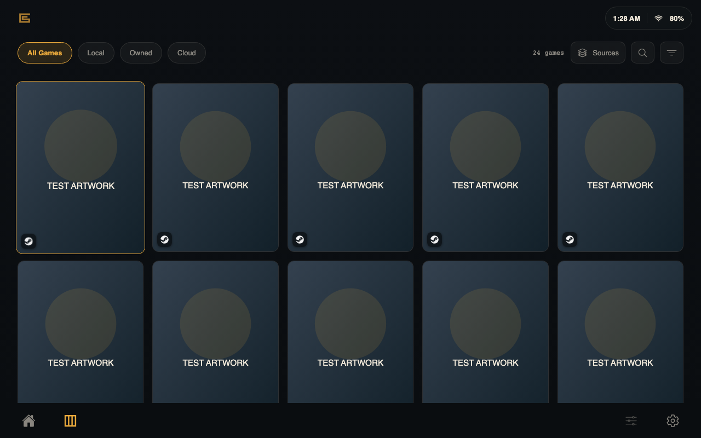
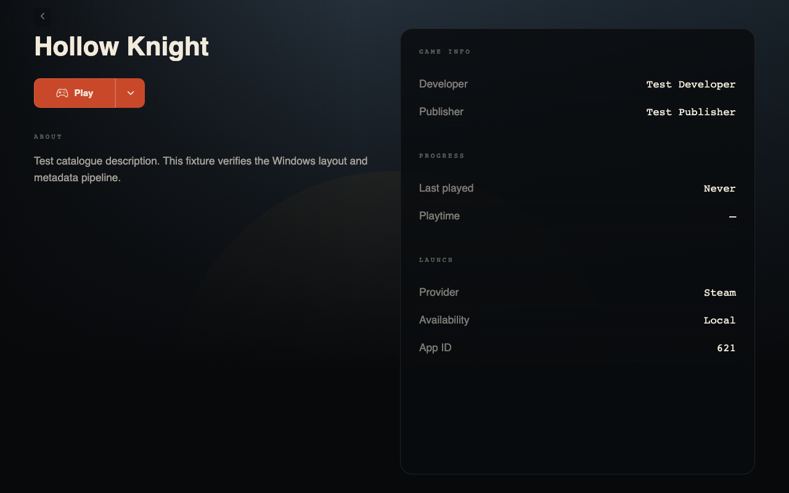

# CreteOS for Windows

A controller-first Windows launcher based on [LiftOff](https://github.com/PixelateWizard/LiftOff), with CreteOS branding, charcoal surfaces, amber navigation and red launch actions. This is a separate Windows application; the Android launcher at the repository root remains independent.

LiftOff supplies game discovery, library management, controller navigation, account integrations and Windows game handoff. CreteOS supplies Android-style Home, Library and game details, the official logo, visual defaults, application identity, isolated local data and Windows-specific release selection. [Upstream provenance and licensing](UPSTREAM.md) are retained with the source and installer resources.

## Start in Xbox Mode

The initial integration uses [AnyFSE](https://github.com/ashpynov/AnyFSE) as the Windows home app. AnyFSE starts `creteos.exe` and the selected GPD utility. TDP stays under that utility's control. Stock AnyFSE appears as **AnyFSE** in Windows' home-app selector; this fork does not register a separate CreteOS home-app package yet.

Follow [Windows and GPD setup](docs/WINDOWS_SETUP.md). Installing CreteOS alone does not change the Windows shell or enable startup into Xbox Mode.







Previews from the running frontend with mocked native commands and clearly labeled test artwork. Layout references are the active Android source and the user-supplied screenshots in `../reference/android-ui/`. [Validation record](docs/VALIDATION.md).

## Develop and build

Use Windows, Node 24, Rust stable, the MSVC C++ build tools, Windows SDK and WebView2. Run from this directory:

```powershell
npm ci
$env:SGDB_API_KEY = "" # Optional SteamGridDB artwork key.
npm run tauri -- dev
```

Create an installer with `npm run tauri -- build --locked`. The unsigned installer is written under `src-tauri/target/release/bundle/`. Supply a SteamGridDB key through the build environment if artwork lookup is needed; no key is bundled in this repository.

```powershell
npm run build
npm test
npx playwright install chromium
npm run test:e2e
cargo test --locked --manifest-path src-tauri/Cargo.toml
```

The GitHub workflow `.github/workflows/windows.yml` performs these checks and produces a Windows installer artifact. It does not publish releases. Future Windows releases must use `windows-v<version>` tags so the updater ignores Android releases. Automatic update checks default to off.

## Verification limits

The browser suite mocks Tauri commands and verifies the frontend, controller navigation and dialogs. It cannot verify Windows discovery, installer behavior, FSE transitions, credential storage or GPD hardware controls. Those require a Windows build and the device checklist in the setup guide. This initial fork is not yet validated on a GPD device.

See [privacy and services](PRIVACY.md) and the preserved [upstream README](UPSTREAM-README.md) for inherited features.
